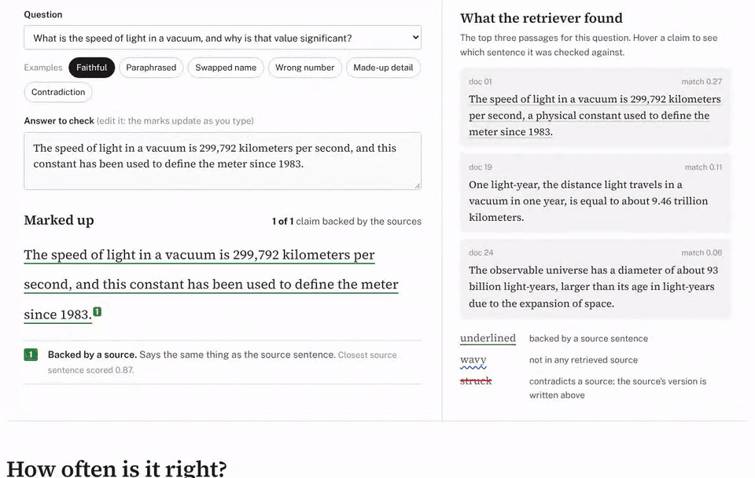
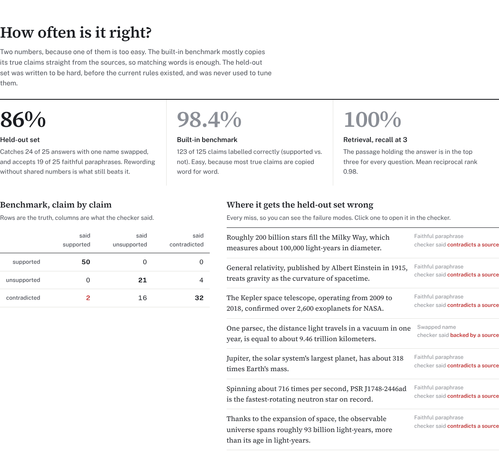
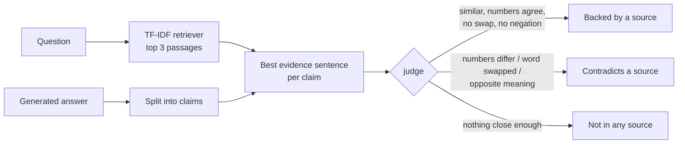

# RAG Faithfulness Detector

**Does the answer say what the sources say?** A claim-by-claim fact-checker for retrieval-augmented generation that marks up an answer the way a fact-checker would: underlined if a source backs it, wavy if no source mentions it, struck through if it contradicts one (with the source's version written above). It runs fully offline, in Python or entirely in your browser.

**[Try it live](https://janat-yasser.github.io/rag-faithfulness-detector/)**, no install.




[](https://github.com/Janat-Yasser/rag-faithfulness-detector/actions/workflows/ci.yml)


## Why it's interesting

- **It reports the honest number.** The built-in benchmark is easy (most true claims copy the source word for word), so 98% there means little. The headline is **86% on a held-out set** of faithful paraphrases and one-name swaps, written before the current rules existed and never used to tune them. The first version scored 46% on it.
- **It catches swapped names, not just wrong numbers.** "The speed of light in *water*", "*Pioneer* 10 crossed into interstellar space": word alignment finds the word standing where the source has a different one. That raised name-swap detection from 12% to 96%.
- **It shows its work.** Every verdict has a reason, the source sentence it was checked against, and the words they share. Hover a claim in the app to light them up.
- **Same code in two languages.** The browser app reimplements the retriever and checker in plain JavaScript with scikit-learn-identical tokenisation, and a test checks that both give the same label on all 225 challenge claims.



## How it works



Signals, in `src/faithfulness.py`: TF-IDF similarity; number checks (exact for years, 5% tolerance for hedged figures like "about 300,000"; numbers inside names like "Voyager 1" are skipped); whole-word negation and opposite pairs; a word-alignment **substitution check**; and **number-anchored support**, so paraphrases that keep the facts count as backed.

## Quick start

```bash
pip install -r requirements.txt
python main.py        # retrieval, scoring, both challenge sets, outputs/REPORT.md
pytest                # includes Python/browser agreement
```

Or just open `faithfulness_audit_app.html`. After changing the template or data, rebuild it with `python build_app.py`.

<details>
<summary>Results in detail</summary>

| | v1 (original) | v2 (current) |
|---|---|---|
| Benchmark: binary accuracy | 100% | 98.4% |
| Challenge set A: overall | 24% | 76% |
| **Challenge set B (held out): overall** | **46%** | **86%** |
| Paraphrases accepted (B) | 80% | 76% |
| Name swaps caught (B) | 12% | 96% |

v1 was a word-overlap test: it rejected paraphrases and accepted almost any swapped name. v2 also fixes three bugs that let false claims through or flagged true ones: years matched within 2% (1989 accepted for 2012), numbers in names counted as facts, and substring negation (the "no" in "known").

Retrieval: recall@3 = 1.0, MRR = 0.98. The questions were written from the documents, so that's optimistic too.

</details>

<details>
<summary>Where it still fails</summary>

- Synonym paraphrases ("little moons" for "small moons") look like substitutions.
- Meaning carried by negation ("*no* star is closer") looks like a polarity flip.
- Contradictions without a number, negation or word swap ("at the outer edge" vs "at the center") get through.

These are the cases an NLI/entailment model handles. The next step is plugging one in behind the same `judge()` interface and comparing it on set B. The app's results section lists every held-out miss; click one to open it in the checker.

</details>

<details>
<summary>The data</summary>

- `data/corpus.json`: 25 short documents on astronomy and space physics, in original wording from well-established facts.
- `data/generated_answers.json`: 100 answers, 4 per question. One is faithful; three each carry one labelled problem: a wrong **number**, a **made-up** sentence, or a **contradiction** ("largest" for "smallest", a negation).
- `data/challenge_set.json` (A) and `data/challenge_set_b.json` (B, held out): a faithful paraphrase and a one-name swap per fact.

</details>

<details>
<summary>Context: the survey this accompanies</summary>

Companion project to "A Systematic Review of Key Retrieval-Augmented Generation (RAG) Systems" (Oche, Folashade, Ghosal & Biswas, 2025), sections 6.3 (RAGAS-style groundedness), 7.2.3 (hallucination) and 7.5.4 (mitigations). RAGAS asks an LLM whether each claim is entailed by the retrieved context; this is a transparent, offline stand-in for that judge. Because the hallucinations are injected deliberately, there's exact ground truth to measure against, which a real LLM's free-form output can't give you.

Limitations beyond the checker itself: the retriever is TF-IDF rather than a dense encoder (a drop-in change in `src/retriever.py`), and claims are split by sentence rather than by a real atomic-fact extractor.

</details>

<details>
<summary>Project layout</summary>

```
main.py                       full pipeline
src/retriever.py              TF-IDF retriever
src/faithfulness.py           the checker (judge + reasons)
src/challenge.py              held-out challenge sets
src/evaluate.py, report.py    metrics, charts, REPORT.md
app_template.html, build_app.py   the browser app and its build
faithfulness_audit_app.html   built app (GitHub Pages)
fonts/                        Source Serif 4, Public Sans (OFL)
tests/                        pytest suite
```

</details>

© 2026 Janat Yasser. All rights reserved. See [LICENSE](LICENSE).