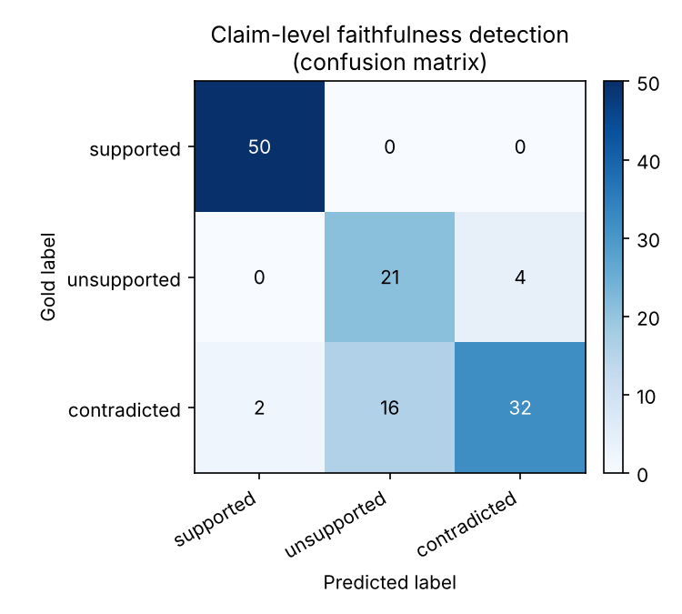
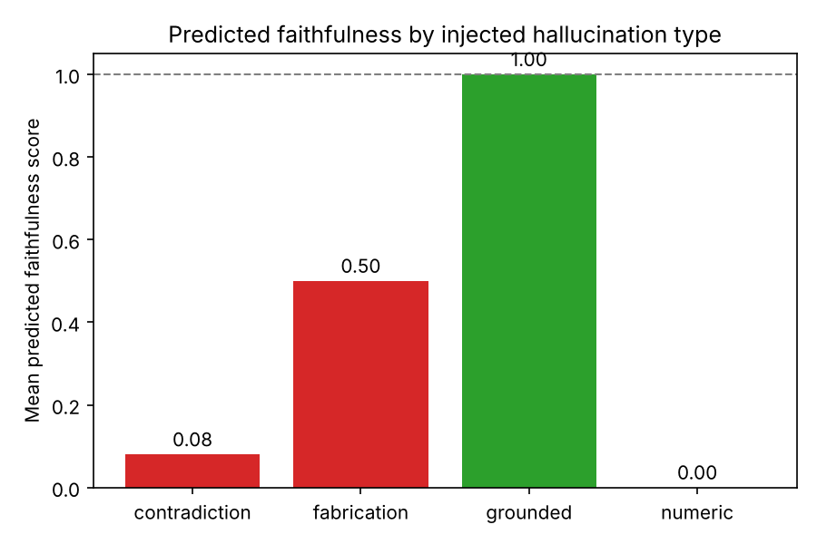

# RAG Faithfulness Detector — Evaluation Report

This report evaluates a RAGAS-style, offline faithfulness/groundedness detector (see Section 6.3 and 7.5.4 of *A Systematic Review of Key Retrieval-Augmented Generation (RAG) Systems*) against a synthetic benchmark with known, claim-level hallucination labels.

## 1. Retrieval quality (Section 6.1/6.2 metrics)

- Recall@k: **1.0**
- MRR: **0.98**

## 2. Claim-level hallucination detection (binary: supported vs hallucinated)

| Class | Precision | Recall | F1 | Support |
|---|---|---|---|---|
| supported | 0.96 | 1.00 | 0.98 | 50 |
| hallucinated | 1.00 | 0.97 | 0.99 | 75 |

Overall accuracy: **0.98**

## 3. Claim-level detection, 3-class (supported / unsupported / contradicted)

| Class | Precision | Recall | F1 | Support |
|---|---|---|---|---|
| supported | 0.96 | 1.00 | 0.98 | 50 |
| unsupported | 0.57 | 0.84 | 0.68 | 25 |
| contradicted | 0.89 | 0.64 | 0.74 | 50 |

## 4. Answer-level faithfulness score by injected hallucination type

- **contradiction**: 0.08
- **fabrication**: 0.5
- **grounded**: 1.0
- **numeric**: 0.0

## 5. Held-out challenge sets (the honest numbers)

The benchmark above was built from the corpus sentences themselves, so it is easy: most 'grounded' claims are copied word for word. The challenge sets test the two cases that matter in practice: faithful **paraphrases** (should pass) and **entity swaps** (should be flagged). Set B was written before the v2 rules and wasn't looked at while developing them.

| Set | Paraphrases accepted | Entity swaps caught | Overall | n |
|---|---|---|---|---|
| A (seen during v2 development) | 64% | 88% | **76%** | 50 |
| B (held out) | 76% | 96% | **86%** | 50 |

## 6. Notes and limitations

- The detector uses TF-IDF similarity + numeric/polarity heuristics as a transparent, offline proxy for the NLI/entailment model that RAGAS normally relies on (per Section 6.3, RAGAS uses an LLM judge). Real deployments should validate against human judgments, as the survey notes in Section 7.3.4 (Accountability and Transparency).
- Remaining failure modes: paraphrases that swap words for synonyms ("little" for "small") read as substitutions; meaning expressed through negation ("no star is closer") reads as a polarity flip; and contradictions with no number, negation or word swap ("at the outer edge" vs "at the center") slip through. These are exactly what an NLI/entailment model handles, consistent with Section 7.2.3's point that no current approach fully eliminates hallucination.
